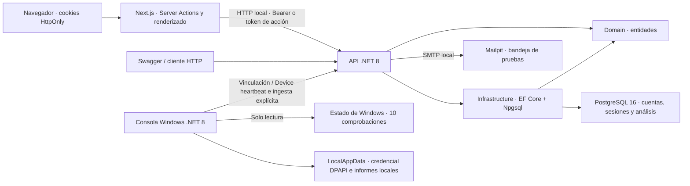
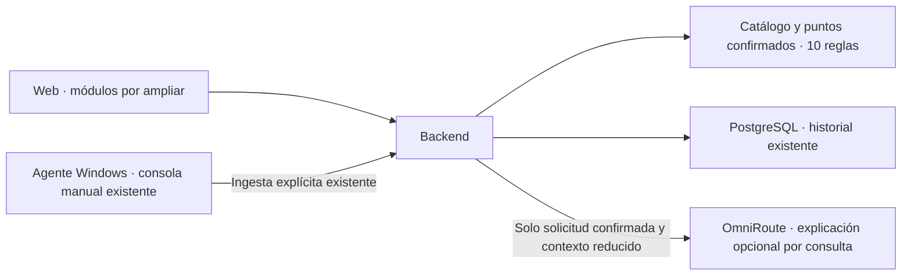

# Arquitectura de Security Center AI

Estado documentado: **2026-10-26**. La guía maestra v1.0 del 27 de julio de
2026 define el objetivo del producto. Esta arquitectura distingue el código
actual de las funciones futuras; las pruebas realizadas están en
[CHANGELOG.md](CHANGELOG.md).

## Componentes actuales

La web usa Next.js 16.4.2 App Router, React 19.3.1 y TypeScript 5.9.3.
La API utiliza ASP.NET Core .NET 8, EF Core y Npgsql. PostgreSQL 16 almacena
cuentas, sesiones, dispositivos y la base de resultados. Mailpit captura correo de desarrollo.
La consola Windows .NET 8 añade vinculación, heartbeat y diez comprobaciones
locales y envío manual. La API valida el reporte y calcula puntos confirmados
y cobertura con un catálogo versionado propio. La explicación opcional de IA
usa un adaptador de servidor a OmniRoute, desactivado por defecto. El usuario
habilitó la configuración local con clave de producto y modelo `openrouter/free`;
la API ya se reinició con el alias corregido y quedó habilitada para una prueba
explícita desde la interfaz. El catálogo autorizado contiene
ese único modelo, sin inferencia externa comprobada; la guía local sigue disponible.

| Componente | Responsabilidad | Ubicación |
| --- | --- | --- |
| Web | Formularios, cuenta, dashboard, cookies y operaciones autenticadas desde el servidor. | [SecurityCenterAI.Web](src/SecurityCenterAI.Web) |
| API | Contratos HTTP, autenticación, sesiones, tokens de cuenta, correo y límites. | [SecurityCenterAI.Api](src/SecurityCenterAI.Api) |
| Domain | Cuenta, sesiones, dispositivos, códigos y credenciales, análisis, reglas y hallazgos. | [entidades](src/SecurityCenterAI.Domain/Entities) |
| Infrastructure | Modelo EF, relaciones, concurrencia, conexión y migraciones. | [SecurityCenterAI.Infrastructure](src/SecurityCenterAI.Infrastructure) |
| Agente Windows | Consola manual, cliente HTTP acotado, credencial protegida y diez comprobaciones locales de solo lectura. | [SecurityCenterAI.Agent](src/SecurityCenterAI.Agent) |
| Servicios locales | PostgreSQL persistente y Mailpit de pruebas, expuestos en loopback. | [Compose](docker-compose.yml) |

Las dependencias son `Api → Infrastructure`, `Api → Domain` e
`Infrastructure → Domain`. Domain no depende de las otras capas. Los
controladores y servicios usan `AppDbContext`; la ingesta y el cálculo se
mantienen separados del transporte HTTP, mediante DTO explícitos, inyección de
dependencias, operaciones asíncronas y cancelación. No hay una capa independiente
de casos de uso.

## Navegador y servidor Next.js

Las rutas son `/register`, `/login`, `/dashboard`, `/account`, `/devices`,
`/forgot-password`, `/reset-password`, `/verify-email` y `/session/renew`.
Dashboard y cuenta requieren una sesión aceptada por la API. La interfaz presenta
carga, error y ausencia de análisis; no crea resultados ficticios.

Next.js intermedia las solicitudes mediante Server Actions. Conserva el access
token en `security_center_session` y el refresh opaco en
`security_center_refresh`; ambas cookies usan `HttpOnly`, `SameSite=Lax`,
`Path=/` y `Secure` en producción. La primera vence con el access token y la
segunda con la credencial de renovación. No se utiliza `localStorage`.

El parser web lee claims y vencimiento para manejar navegación. No verifica
la firma ni concede permisos: .NET valida firma y sesión en la base.
`/account` consulta `/api/auth/me` para obtener el estado actual del correo,
en vez de tratar un claim antiguo como un perfil actualizado.

La renovación se realiza mediante una Server Action que puede escribir cookies.
`/session/renew` presenta ese recorrido cuando el access token ya venció;
la navegación GET por sí sola no llama al endpoint de renovación. Cuenta y
dashboard también coordinan la renovación mientras están abiertas. El uso
concurrente de un refresh antiguo puede revocar su sesión, por lo que no debe
tratarse la rotación como una operación libremente repetible.

Los formularios de verificación y recuperación leen el token del enlace y
exigen una acción POST para consumirlo. Esas páginas usan `no-referrer` y
`no-store`; la configuración de desarrollo omite sus solicitudes en el log
de entrada de Next.js. Esto no controla registros de un proxy o hosting futuro.

`API_BASE_URL` es exclusiva del servidor, por defecto
`http://localhost:5169`. Las solicitudes usan `cache: no-store` y timeout de
12 segundos. La clave JWT y las credenciales de PostgreSQL permanecen en el
backend. La web local se abre en `http://localhost:3000`.

## Autenticación y sesiones

Las contraseñas usan `PasswordHasher<User>`; el contrato actual exige
15 puntos Unicode como mínimo y 128 unidades UTF-16 como máximo para claves
nuevas en registro y recuperación, además de la lista local inicial de valores
previsibles. Login conserva compatibilidad con claves anteriores. Se normaliza el correo y su
índice es único. No hay MFA ni un corpus amplio de contraseñas comprometidas.

El access token usa HMAC SHA-256, emisor, audiencia, expiración y los claims de
usuario y sesión. Su vigencia configurada es de 15 minutos, con 30 segundos
de tolerancia de reloj. `MapInboundClaims = false` conserva los nombres
originales. El middleware consulta el `sid` en PostgreSQL: una sesión
revocada, vencida o ajena al usuario invalida el token aunque su firma sea válida.

Los refresh son opacos, aleatorios y se guardan como SHA-256. Se rotan y tienen
una vigencia máxima de 30 días. Las credenciales consumidas se conservan para
detectar reutilización: volver a presentar una revoca la sesión asociada.
Los marcadores de concurrencia protegen las actualizaciones. El mantenimiento
técnico opcional elimina sesiones cerradas antiguas con sus refresh en cascada;
conserva todos los hashes mientras la sesión siga activa. Está desactivado por defecto.

Logout solicita revocación y borra las cookies del navegador. Si la API no
responde, la web informa del cierre local: una copia del token puede seguir
activa y la revocación remota queda sin confirmar. El cierre global
y el restablecimiento de contraseña revocan las sesiones de la cuenta.
Borrar solo una cookie no sustituye esa operación de backend.

## Correo, recuperación y controles de abuso

El correo de verificación y recuperación contiene un token opaco cuyo hash y
propósito se guardan en la base. Verificación dura 24 horas; recuperación,
30 minutos. Un token inválido, vencido, consumido o de propósito distinto
no permite completar la acción. El enlace se construye con `FrontendUrl`
configurada y no con el encabezado Host de una solicitud.

El registro permite entrar al dashboard mientras el correo está pendiente.
La cuenta muestra ese estado y permite pedir reenvío. Recuperación responde
de forma genérica; no entrega el token en su respuesta. Después de cambiar
la contraseña se exige login normal.

El bloqueo de login se activa tras 5 fallos y dura 15 minutos. El envío tiene
60 segundos de espera por cuenta y tipo de correo. Recuperación aplica un mínimo
de 300 ms; login inexistente realiza una verificación de hash de comparación.
Estas medidas reducen diferencias, sin garantizar tiempos idénticos.
Los límites de solicitudes por IP se mantienen
en memoria: 120/minuto global, 60/minuto de autenticación y 40/minuto de correo.
La API ve la IP de Next.js cuando actúa como intermediario y no confía en
`X-Forwarded-For`. Queda por definir la operación con proxies y varias instancias.

En desarrollo SMTP usa Mailpit: `127.0.0.1:1025` y bandeja
`http://localhost:8025`. Se valida que el host SMTP sea loopback en
Development/Testing. Fuera de esos entornos se requiere host y remitente
explícitos, usuario, contraseña, TLS y `FrontendUrl` HTTPS. No se ha elegido
un proveedor de producción. Mailpit contiene enlaces sensibles de prueba,
admite hasta 200 mensajes y no tiene volumen persistente en Compose.

La API prepara un registro cifrado de correo en el mismo DbContext/transacción
que la operación. Un worker reserva filas y las envía fuera de la solicitud HTTP.
La cola e intentos sobreviven al reinicio; no se guardan destinatarios o tokens en
claro. Claves persistentes bajo DPAPI de la identidad Windows de la API, fuera del
repositorio. La respuesta genérica de recuperación no confirma entrega SMTP.
[Diseño y límites](docs/MAIL_DELIVERY.md).

## Dispositivos y autorización separada

La web `/devices` opera como propietario con Bearer de usuario. Crear el registro
y emitir códigos exige correo verificado en la base y un máximo de un dispositivo
no revocado por cuenta. Un código de vinculación de un uso dura diez minutos y
su hash se almacena en la base. El canje entrega una credencial opaca propia,
válida durante 90 días, y consume el código de forma coordinada con la emisión.

El esquema `Device` autoriza heartbeat e ingesta del dispositivo vinculado; no permite
usar los endpoints de usuario. Bearer tampoco sustituye esa credencial en el
endpoint del cliente. El heartbeat actualiza el último contacto: no recoge
datos de Windows ni produce análisis o puntajes.

Regenerar invalida los códigos previos y mantiene una credencial existente hasta
el canje nuevo; este revoca la anterior. Revocar el dispositivo invalida códigos
y credenciales. Reset de contraseña revoca también esos secretos sin borrar
el registro ni el historial; logout-all solo revoca sesiones web. El estado
`linked` depende de una credencial vigente, mientras `pairedAtUtc` conserva la
fecha histórica. Las transiciones y los límites se comprueban en el backend.

Esta identidad de cliente no acredita identidad física del hardware. La consola
Windows utiliza este protocolo y protege su credencial local. El protocolo y sus límites están en
[docs/DEVICES.md](docs/DEVICES.md).

## Agente Windows de consola

`SecurityCenterAI.Agent` es una aplicación .NET 8 Windows de ejecución manual.
Sus comandos son `pair`, `heartbeat`, `status`, `scan`, `send`, `forget` y `help`,
expuestos también por `scripts/agent.ps1`. No es un servicio y no se registra
para iniciar con Windows. El uso completo está en [docs/WINDOWS_AGENT.md](docs/WINDOWS_AGENT.md).

`pair` lee el código mediante entrada interactiva oculta y canjea la credencial
sin utilizar contraseña o sesión de la cuenta. La URL de la API y la credencial
devuelta se guardan en `%LOCALAPPDATA%\SecurityCenterAI\Agent\credential.enc`,
protegidas con DPAPI `CurrentUser`. La URL queda ligada a la credencial para que
heartbeat use su destino original. El cliente exige HTTPS salvo HTTP en localhost
o una dirección IP de loopback exacta; no sigue redirecciones y acota tiempos
y respuestas. `status` consulta el estado local sin acreditar revocación remota.
`forget` borra la copia local, sin revocar el dispositivo ni borrar informes.

`scan` funciona sin vinculación y no hace solicitudes de resultados a la API
salvo cuando se solicita `--send` explícitamente.
Ejecuta consultas predeterminadas de solo lectura, selecciona campos de evidencia
y evalúa diez reglas locales versionadas. Un fallo de permisos, módulo ausente
o lectura inválida se conserva como desconocido o no aplicable según la evidencia,
sin convertirse en aprobación. Cada resultado incluye estado, evidencia,
severidad y recomendación; el cliente no calcula el puntaje. El informe JSON se guarda en
`%LOCALAPPDATA%\SecurityCenterAI\Agent\reports` al solicitar el análisis manual.
No se almacena la salida completa de cmdlets, seriales, nombre de usuario o
claves de recuperación. Los errores no deben exponer esos datos.

El informe del esquema 2 añade un UUID estable y puede enviarse con `scan --send`
o `send`. La API acepta únicamente observaciones de las diez reglas conocidas;
su catálogo determina los textos, severidad, recomendaciones y pesos, sin
confiar en esos metadatos del agente. `heartbeat` únicamente envía la versión
declarada del agente. La ingesta registra plataforma `Windows` por el protocolo
de las diez reglas; no verifica de forma remota la plataforma o el binario.

El cliente HTTP, la bóveda y las consultas son componentes separados. Reciben
por constructor sus dependencias, como `HttpClient`, `TimeProvider` e
`IWindowsProbe`; se utilizan DTO explícitos, métodos asíncronos y cancelación.
Quedan
instalador firmado, distribución, servicio, actualizador y controles
de operación de producción.

## Ingesta manual y cálculo

`POST /api/agent/analyses` requiere exclusivamente autenticación Device y obtiene
la cuenta y dispositivo de la credencial. El contrato del esquema 2 incluye
identificador estable de reporte, versión del cliente, fechas y exactamente
diez observaciones con regla/version, estado y evidencia seleccionada.
No permite elegir propietario, dispositivo, puntaje o pesos. La API valida
estructura, reglas admitidas, tamaño y fechas antes de guardar.

El identificador es único por dispositivo; un hash canónico del contenido
distingue reintentos idénticos (`200`) de reutilización con contenido diferente
(`409`). El primer envío devuelve `201`. Se guardan análisis y diez resultados
de forma coordinada; un reintento no crea otro historial. Las fechas declaradas
se conservan separadas de la recepción del servidor. La credencial se comprueba
en la base y no autoriza después de su revocación o vencimiento.

Después de eliminar un análisis con `reportId`, la marca mínima del dispositivo
y reporte prevalece sobre el reintento: la ingesta devuelve `410` y no restaura
ese identificador. La versión `0.4.1-preview.1` de la consola pide un escaneo nuevo
sin borrar la credencial o el archivo local y sin reintento automático.

El cálculo versión 1 suma pesos de resultados `passed` sobre el peso aplicable.
`attention` no suma puntos y cuenta como conocido; `unknown` no suma puntos ni
se etiqueta como riesgo comprobado; `notApplicable` se excluye del denominador.
Cuando no hay conocidos el puntaje es `null`. La cobertura cuenta conocidos
sobre reglas aplicables, con valor 0 si ninguna es aplicable. El detalle
presenta las cuatro categorías y la falta de datos, sin convertir desconocidos
en aprobaciones ni sugerir una auditoría completa.

La autenticación prueba posesión de una credencial, no ejecución del binario ni
verdad de la evidencia. El reporte sigue siendo autodeclarado. El servidor no
consulta Windows remotamente. Las limitaciones y el protocolo preciso están en
[docs/ANALYSIS_INGESTION.md](docs/ANALYSIS_INGESTION.md).

## Persistencia

| Entidad / tabla | Finalidad y relación |
| --- | --- |
| `User` / `users` | Perfil, hash, correo verificado y estado de intentos y envíos. Correo único y marcador de concurrencia. |
| `UserSession` / `user_sessions` | Usuario, creación, vencimiento y revocación de cada sesión. |
| `RefreshCredential` / `refresh_credentials` | Hash de refresh, sesión, vigencia y consumo; hash único y concurrencia. |
| `AccountActionToken` / `account_action_tokens` | Hash, usuario, propósito, vigencia y consumo de enlaces de cuenta. |
| `SecurityAnalysis` / `security_analyses` | Cuenta/dispositivo, puntaje opcional, esquema/reporte/huella, captura y recepción, versión del cálculo y conteos. Metadatos opcionales conservan el historial legacy. |
| `Device` / `devices` | Propietario, nombre, fechas, versión de cliente declarada y estado de revocación. Índice parcial de un dispositivo no revocado por cuenta. |
| `DevicePairingCode` / `device_pairing_codes` | Hash del código, dispositivo, vencimiento, consumo, revocación y concurrencia. |
| `DeviceCredential` / `device_credentials` | Hash de credencial y vigencia; índice parcial de una credencial no revocada por dispositivo. |
| `SecurityRule` / `security_rules` | Clave compuesta de id y versión positiva, título, descripción y creación. Catálogo del servidor para las diez reglas admitidas; sin comandos remotos. |
| `SecurityFinding` / `security_findings` | Análisis, versión de regla, estado explícito y metadatos/evidencia/recomendación como instantáneas. Referencia compuesta a regla con borrado restringido. |
| `AnalysisFeedback` / `analysis_feedback` | Valoración privada por usuario/análisis, comentario, versión de guía y fechas. Se elimina junto con el análisis. |
| `DeletedAnalysisReport` / `deleted_analysis_reports` | Clave compuesta dispositivo/reporte y fecha de eliminación. Impide reingesta del mismo identificador; sin hash, puntos o evidencia. FK a dispositivo con cascada, sin purga automática. |

Las once propiedades persistidas de `User` se mapean con `HasColumnName` a
columnas en español en `users`: identificador `id_usuario`, perfil
`nombre_completo`/`correo_electronico`, hash `hash_contrasena` y campos de
seguridad y fechas descritos en [README.md](README.md#columnas-de-users).
Las propiedades C# y los contratos JSON conservan sus nombres. Las otras tablas
mantienen sus columnas y relaciones; las claves foráneas pasan a referenciar
`users.id_usuario`. El renombrado se versiona en una nueva migración, sin
reescribir las migraciones iniciales ni borrar datos.

El `Up` de `20261021120952_RenameUserColumnsToSpanish` ejecuta once operaciones
`RenameColumn` y un `RenameIndex` para `IX_users_correo_electronico`.
Su `Down` restaura los nombres anteriores; no recrea tablas o columnas.

Las relaciones dependen del usuario y tienen borrado en cascada. El endpoint
de eliminación de cuenta descrito abajo utiliza esas relaciones. El inventario exacto, cookies,
correo y retención están en [PRIVACY_NOTES.md](PRIVACY_NOTES.md).

La migración `20261021114159_AccountSessionsAndRecovery` agrega seis columnas
al usuario y las tres tablas de cuentas a la migración inicial, sin eliminar
cuentas ni análisis. Las cuentas previas comienzan con `EmailVerified=false`.
Los JWT anteriores carecen de `sid`: requieren volver a iniciar sesión.

El dashboard devuelve `securityScore`, `totalAnalyses` y
`recentAnalyses`, hasta cinco registros por fecha descendente y filtrados
por usuario. Sin datos devuelve puntaje `null`, total 0 y lista vacía.
La ruta no ejecuta un análisis ni calcula puntajes.

El detalle de dispositivo filtra por usuario y equipo: hasta 20 análisis
recientes y 100 hallazgos por análisis. La lista devuelve hasta 100 dispositivos.
Son lecturas acotadas, sin paginación. Los análisis legacy con
`DeviceId=null` conservan su pertenencia al usuario en el dashboard y no se
atribuyen artificialmente a un equipo nuevo.

La migración `20261021123143_DevicesAndFindingFoundation` añade cinco tablas y
`security_analyses.id_dispositivo` nullable. Las columnas nuevas utilizan
español y las anteriores conservan sus nombres. La creación y las actualizaciones
de vinculación usan índices parciales y concurrencia. Pair y reemisión avanzan
también la versión del usuario para detectar carreras con restablecimiento de
contraseña; el canje utiliza una transacción relacional para sustituir la
credencial sin un estado intermedio visible.

## Configuración y verificación local

`global.json` selecciona SDK 8.0.4xx y el manifiesto local fija
`dotnet-ef` 8.0.11. `scripts/dev.ps1` carga las cuatro variables
admitidas de `.env` sin ejecutar su contenido; prepara conexión y clave JWT
solo para el proceso y restaura el entorno al salir. .NET no lee ese archivo
por sí solo. El helper inicia servicios, aplica migraciones y ejecuta la API
en el perfil HTTP y fija `ASPNETCORE_ENVIRONMENT=Development` para su proceso.
Admite `-Configuration` (por defecto Debug, también para EF y pruebas) y
`-Port` (por defecto 5169) para aislar binarios y dirección de otra instancia.
`migrate` requiere base disponible y `test` no necesita `.env`. El helper no
es un procedimiento de despliegue de producción.

Compose publica PostgreSQL en `127.0.0.1:5432` y conserva sus datos en
`postgres_data`. La API y la web corren en el anfitrión. El Dockerfile
de la API permite construir una imagen, pero Compose no despliega la web/API.
Los comandos están en [README.md](README.md).

Las pruebas del backend usan EF InMemory y correo capturado en memoria; no
validan por sí mismas SQL, migraciones o SMTP reales. Los E2E usan Chromium,
API, web, PostgreSQL y correo local de prueba; las cuentas se eliminan por
correo exacto y sus registros en cascada. Trazas, vídeos y capturas automáticas
están deshabilitados. Las capturas opcionales de revisión usan datos ficticios.
Los conteos y resultados de cada bloque constan en [CHANGELOG.md](CHANGELOG.md).

## Arquitectura objetivo de la guía

Quedan ampliar distribución y operación del agente y validar inferencia real
para la explicación opcional de IA ya configurada por el usuario. El
recorrido manual de diez reglas ya conecta consola, API y web mediante un
cálculo determinista limitado. No equivale a una revisión completa de Windows.

El recorrido previsto es vincular el agente con un código temporal, entregar
una credencial propia y revocable, obtener evidencias con permisos mínimos,
evaluarlas con reglas y mostrar prioridades y recomendaciones en la web.
La IA explicará esos hechos; no decidirá el estado de Windows sin evidencia.
El agente no ejecutará comandos arbitrarios ni enviará archivos personales
fuera del alcance aprobado.

La sesión de cuenta no sustituye la credencial de dispositivo. Las recomendaciones
ejecutables y la auditoría completa siguen pendientes; las diez reglas y la
consulta de instantáneas no implementan esos procesos.
No se comprobó inferencia externa de IA; correo externo
y hosting de producción siguen pendientes.
La conservación de contenido, operación de copias y producción siguen pendientes.
Existe backup manual cifrado con ensayo aislado, descrito abajo.
Existe mantenimiento técnico opcional de autenticación, descrito abajo.
El control individual de análisis se describe abajo.
Las decisiones se conservan en [DECISIONS.md](DECISIONS.md).

## Guías locales y feedback implementados

La web consulta un análisis por propietario/dispositivo/UUID. La API selecciona
plantillas v1 por regla, versión y estado sin enviar evidencia a modelos externos.
PostgreSQL conserva una valoración privada por usuario/análisis en `analysis_feedback`.
El índice único y los reintentos protegen primeros envíos concurrentes; las
ediciones posteriores reemplazan la valoración. El acceso usa sesión Bearer y
mantiene el historial de dispositivos revocados.
[Contrato y límites](docs/LOCAL_GUIDES_AND_FEEDBACK.md).

## Explicación opcional de IA por análisis

El backend expone consulta de disponibilidad y solicitud confirmada en
`/api/devices/{deviceId}/analyses/{analysisId}/ai-explanation`, con Bearer,
sesión activa, correo verificado y autorización conjunta de propietario/equipo/análisis.
El navegador no elige modelo, destino o instrucciones. El servicio construye el
contexto con puntos/cobertura y las diez reglas: identificador, versión y estado,
con títulos, descripciones y límites del catálogo local. Excluye evidencia libre,
identificadores de cuenta/equipo/informe, nombres, correo, fechas, feedback y archivos.

La conexión OpenAI-compatible permanece en la API; la clave del producto se
separa de la de desarrollo. Se comprueba un JSON de esquema cerrado con las diez
reglas únicas antes de presentar texto escapado por React. Acciones manuales y
referencias provienen de la guía local. No modifica resultados o ejecuta acciones.
Fallo, cuota o respuesta incompatible conservan la guía local como alternativa.

No agrega tablas, migraciones, historial de conversaciones ni persistencia de
resultados de IA. La web conserva el resultado solo en memoria de la página.
La cuota inicial de cinco intentos diarios UTC por propietario y concurrencia
de cuatro globales/uno por propietario viven en memoria de una sola API; reiniciar
los restablece y no coordinan varias instancias. La configuración local es optativa,
con custodia Windows DPAPI CurrentUser fuera del repositorio.
[Contrato, configuración y límites](docs/AI_EXPLANATIONS.md).

La visión posterior incluye escritorio con bandeja y vigilancia opcional. Antes
de automatizar análisis o acciones habrá que definir alcance, plan, autorizaciones
y controles por operación. La consola actual y este módulo no implementan esa autonomía.

## Distribución portátil del agente

`scripts/publish-agent.ps1` publica exclusivamente la consola para `win-x64`,
con runtime incluido y sin trimming ni bundling de archivo único. El ZIP contiene
binarios, ayuda offline, acceso `.cmd`, wrapper opcional y manifiesto de integridad.
No incorpora la API, configuración `.env`, credenciales ni informes locales.
`doctor` y `version` se resuelven antes del almacenamiento del usuario; el resto
conserva la ruta fija y DPAPI existentes. La operación es manual y las
actualizaciones reemplazan una carpeta completa; sin servicio, autoarranque o
actualizador. [Uso y compatibilidad comprobada](docs/AGENT_PRIVATE_BETA.md).

## Comparación de análisis

Una consulta Bearer verifica dispositivo y dos análisis del mismo propietario.
La API carga hasta cien comprobaciones por informe sin tracking y une sus reglas,
manteniendo originales y clasificando diferencias de estado por versiones admitidas.
Los puntos y la cobertura se comparan solo con catálogo completo y mismo conjunto
aplicable; los desconocidos conservan su incertidumbre. No se persisten
comparaciones ni se ejecutan acciones en Windows. La web selecciona informes
mediante GET y muestra evidencias originales. [Contrato](docs/ANALYSIS_COMPARISON.md).

## Exportación y borrado individual del historial

`AnalysisHistoryController` y `AnalysisHistoryService` verifican usuario,
dispositivo y análisis con Bearer exclusivo de cuenta. `GET .../export` genera
un adjunto JSON versión 1 mediante DTO explícitos: fecha del servidor,
identificador/nombre del dispositivo, análisis completo con resultados y feedback
propio. No agrega datos de cuenta, secretos o hashes internos; no aplica los
límites de presentación del historial. La respuesta usa `no-store` y `nosniff`.

`DELETE /api/devices/{deviceId}/analyses/{analysisId}` exige
`{ "confirmed": true }`, rechaza campos adicionales y acota el cuerpo a 1 KiB.
En una transacción elimina el análisis, todos sus resultados y todo su feedback;
si tenía reporte, guarda solo dispositivo, reporte y fecha UTC. Los marcadores
de concurrencia de usuario y dispositivo coordinan ingesta y borrado, con
reintentos acotados de la transacción ante conflictos. Un envío concurrente no
debe recrear el identificador eliminado. El catálogo de reglas se conserva.

`20261022194730_PrivateAnalysisHistory` agrega la tabla de esas tres columnas
en español; no modifica filas anteriores en `Up`. La marca dura mientras exista
el dispositivo y su FK la elimina ante borrado físico, no ante revocación.
Los análisis anteriores sin `ReportId` se borran sin marca cuando pertenecen a
un dispositivo accesible. Esto no implementa eliminación de cuenta/dispositivo.

La web presenta **Control de este análisis** al pie de la explicación. La descarga
se transmite desde una ruta autenticada y la eliminación exige checkbox y Server
Action; luego vuelve al historial con un aviso. Los registros restantes determinan
dashboard y comparaciones posteriores. Archivos locales, descargas y backups
quedan fuera de la operación. [Contrato y uso](docs/ANALYSIS_HISTORY.md).

## Exportación de datos de cuenta

`GET /api/account/export` requiere sesión Bearer y obtiene el usuario del claim
autenticado. DTO explícitos agrupan perfil, todos los dispositivos propios,
análisis con todos sus resultados y feedback, y marcas mínimas de eliminación.
Los registros antiguos sin dispositivo se conservan con `deviceId: null`.
Las tablas internas de autenticación y hashes no forman parte de esta copia.

El servicio realiza consultas `AsNoTracking` en serie y una transacción
`RepeatableRead` en PostgreSQL. Las colecciones se leen completas y se relacionan
en memoria, sin aplicar los límites de presentación del historial. La respuesta
se serializa como adjunto JSON después de la lectura; no se guarda un archivo
de exportación ni se modifica el esquema. El coste de memoria de historiales
grandes requiere revisión antes de una operación externa.

Next.js ofrece la descarga en `/account/export` desde **Mi cuenta**. Valida y
reconstruye el contrato antes de entregarlo al navegador, conservando el Bearer
en el servidor. `AccountExport` limita las solicitudes por IP; `/account` y sus
rutas tienen `no-store` y `no-referrer`. [Contrato](docs/ACCOUNT_EXPORT.md).

## Eliminación de cuenta

`DELETE /api/account` obtiene usuario y sesión del Bearer y exige contraseña
actual más `ELIMINAR`. `AccountDeletionService` usa una transacción y un bloqueo
`FOR UPDATE` parametrizado de la fila de usuario antes de revalidar sesión y
contraseña. Los intentos fallidos comparten el bloqueo de login; una confirmación
incorrecta no modifica ese contador. La política `AccountDeletion` limita las
solicitudes por IP y el cuerpo admite hasta 2 KiB sin campos extra.

El borrado de usuario utiliza las cascadas existentes de PostgreSQL para quitar
datos activos, dispositivos y accesos, sin modificar el catálogo. No requiere
migración. Los conflictos/deadlocks se reintentan de forma acotada. Ingesta,
login y refresh tratan los conflictos y referencias a propietarios eliminados
sin aceptar nuevos datos bajo la identidad anterior.

La Server Action limpia las cookies tras un `204` y redirige al login con aviso.
Los archivos locales, correos, colas y backups quedan fuera de la transacción;
una cuenta registrada nuevamente obtiene otro UUID. [Alcance](docs/ACCOUNT_DELETION.md).

## Mantenimiento técnico de autenticación

`RetentionMaintenanceService` consulta o elimina sesiones cerradas, tokens de
cuenta, códigos de vinculación y credenciales de dispositivos que superan su
plazo. No elimina refresh por separado: las cascadas se aplican solo al quitar
una sesión cerrada antigua. Perfil, dispositivos, informes y marcas mínimas
quedan fuera de sus consultas de purga. No modifica el esquema.

La vista previa usa `RepeatableRead`. La aplicación usa `ReadCommitted`, bloqueo
asesor transaccional compartido y un lote por categoría; revalida el predicado
en `ExecuteDeleteAsync`. Cuatro categorías se confirman en una sola transacción
con reintentos acotados ante deadlock/serialización. Los conteos devueltos no
incluyen dependientes borrados por cascada.

El CLI se detecta antes de construir la aplicación web. Crea únicamente el host
de configuración/DI y no lo inicia: no configura JWT, HTTP ni el worker de correo.
`scripts/retention.ps1` proporciona la conexión local sin secretos en argumentos.
La aplicación exige confirmación explícita y habilitación en ese proceso.

En la API, `RetentionWorker` usa un ámbito por ejecución y espera un intervalo
completo antes de la primera. `Retention:Enabled=false` por defecto impide abrir
ámbitos para ese trabajo. Sus logs agregan estado/conteos sin datos de identidad;
no sustituyen auditoría durable. [Opciones, uso y límites](docs/RETENTION_MAINTENANCE.md).

## Backup local y ensayo aislado

`--backup-*` se procesa antes de construir la aplicación web. El helper
`scripts/backup.ps1` compila en otra configuración, prepara la conexión únicamente
para el hijo y envía la contraseña por stdin, sin argumentos o archivo de claves.
No inicia HTTP, correo, workers ni migraciones sobre la base habitual.

`DatabaseBackupService` exporta una instantánea en una transacción de lectura
`RepeatableRead`. El inventario SHA-256 de tablas públicas, columnas, índices y
restricciones y `pg_dump --snapshot` leen esa misma instantánea. La representación
de CHECK se normaliza mediante EXPLAIN sin ANALYZE para conservar su comparación
después de los cambios textuales equivalentes que realiza PostgreSQL al restaurar.

El manifiesto y dump custom se cifran con AES-256-GCM, sal/nonce aleatorios y clave
PBKDF2-SHA256. Límite local de 64 MiB y buffers en memoria; no se escribe dump en
claro. El archivo parcial ya está cifrado. La carpeta dedicada de LocalAppData
recibe ACL para usuario actual y SYSTEM, sin herencia. No se permiten OneDrive,
repositorio, uniones o directorios ajenos al almacén de copias.

Antes de publicar el archivo, el servicio lo abre y autentica, crea únicamente
`scai_restore_test_<UUID>`, restaura con `--single-transaction --exit-on-error`,
compara el inventario y retira esa base en `finally`. Una verificación posterior
puede funcionar aunque no exista la base original. No hay parámetro de destino
activo. [Formato, comandos, pruebas y alcance](docs/DATABASE_BACKUPS.md).

`--backup-rehearse` reutiliza autenticación, restauración y comparación antes de
llamar a `RestoredAccessReset` exclusivamente en ese destino propio. Exige host,
puerto y nombre temporal exactos, las 17 tablas revisadas, columnas/tipos/nulabilidad
del modelo y última migración admitida. En una transacción serializable, bloquea
solo las tablas temporales, vuelve a comprobar el inventario y retira siete
almacenes de accesos, solicitudes/cola de correo incluidas. Renueva versiones de
usuario/dispositivo y revoca equipos. Compara ocho tablas completas y proyecciones
de perfil/dispositivo que excluyen solo las columnas modificadas intencionadamente.
Las diferencias revierten; el `finally` retira la base. Reporta cantidades y
comprobaciones, sin filas o secretos. No arranca host/worker, no requiere claves
DPAPI de correo y no sustituye ni reconcilia la base activa. [Contrato y límites](docs/RECOVERY_REHEARSAL.md).

## Revisión de enlaces/mensajes para 1.0

`LocalScamRules` valida entradas acotadas y aplica reglas locales versionadas;
regex sin backtracking y sin cliente HTTP, DNS o proveedor externo. Solo devuelve
observaciones fijas y dominios/IP, sin entradas completas, rutas o parámetros.
No determina fraude/seguridad o confianza probabilística.

`LinkMessageService` coordina una cuota combinada de 25/día UTC por defecto mediante
`IOptions<LinkMessageOptions>`. Bloquea el usuario, revalida sesión/correo, lee o
crea su único `LinkMessageUsage` y confirma contador/versión juntos. El siguiente
día sustituye el anterior. No se conserva historial de contenidos o resultados.
`GET/POST /api/tools/link-message` usan Bearer y límites existentes, cuerpos
acotados y cabeceras privadas. La credencial Device no autoriza esta herramienta.

Una fila por usuario, cuatro columnas en español, contador no negativo y cascada
de cuenta. La exportación añade metadatos día/cantidad; el backup incluye el
estado. Downgrade bloqueado con filas para no descartar cuotas sin un plan.
No agrega tipos a actividad o analítica de producto.

La web `/tools/scam-check` muestra contador, confirmación, errores y observaciones,
con límites visibles y texto sin enlaces de destino clicables. Limpiar/editar
oculta resultados anteriores y el contenido no se agrega a URLs o estado devuelto
por las acciones. El destino de renovación de sesión entra en la lista cerrada.
[Contrato y privacidad](docs/LINK_MESSAGE_CHECKS.md).

## Presentación de visitantes

La raíz muestra landing para visitantes: registro/login, recorrido, datos y FAQ.
Una cookie de sesión válida conserva redirección al dashboard; un refresh existente
pasa por la renovación anterior. La landing no consulta filas de PostgreSQL ni
agrega analítica, recursos externos o servicios nuevos. Mantiene noindex mientras
la publicación siga pendiente. [Cierre 1.0](docs/RELEASE_1_0.md).

## Actividad privada de seguridad

`SecurityActivity` mantiene cuatro campos: UUID de entrada, propietario, tipo
cerrado y fecha UTC. `SecurityActivityRecorder` solo agrega una entidad al contexto;
el `SaveChanges` y la transacción de la operación confirman ambos juntos. Se
instrumentan catorce acciones de cuenta, sesiones, dispositivos y borrado de análisis.
No hay texto libre, direcciones IP, secretos o identificadores del contenido.

`AppDbContext` rechaza cambios o borrados de entradas existentes
salvo al eliminar la cuenta. El catálogo se valida también mediante CHECK;
la FK elimina las entradas al borrar el propietario. Los reintentos descartan
el seguimiento para evitar eventos de escrituras que no se confirmaron. Los
conflictos con borrado de cuenta se manejan en las rutas de autenticación/dispositivo.

`GET /api/account/security-activity` exige JWT de sesión activa y obtiene el dueño
del claim; comparte `DeviceAccount`. Materializa hasta 51 filas con índice por propietario,
fecha y UUID descendentes y devuelve hasta 50 más `hasMore`/`nextBefore`. El
cursor resuelve el último evento dentro del propietario y filtros, y continúa
por fecha/UUID menores, sin offset. Acción opcional del catálogo y días completos
UTC con formato estricto; fechas invertidas, parámetros repetidos y cursores
inexistentes/ajenos/fuera de filtros producen 400. No modifica datos o índices.
Cada evento conserva un DTO con tres campos públicos. No hay rutas de escritura de historial. La exportación de cuenta
agrega todas las entradas a su instantánea mediante el campo aditivo `securityActivity`.

La web ofrece `/account/activity` desde Mi cuenta, con estados vacío/error,
fechas en America/Asuncion, etiquetas fijas, filtros de días UTC y navegación hacia
eventos anteriores. La exportación de cuenta siempre conserva toda la actividad.
Los enlaces incluyen solo filtros validados; consultas inválidas y fallos no
parecen un historial vacío. Next excluye esta ruta del log entrante de desarrollo.
Renovación de
sesión admite ese destino mediante una lista cerrada de rutas locales.

Es un primer registro persistido por cuenta, sin monitoreo de intentos fallidos,
alertas o protección frente a SQL directo/administradores. No hay purga automática
de estos eventos. [Cobertura, privacidad y pruebas](docs/SECURITY_ACTIVITY.md).

## Monitoreo local y logs mínimos

`/health` conserva respuesta HTTP fija. `/health/ready` usa health checks de ASP.NET
con `PostgresReadinessCheck`: conexión Npgsql y SELECT 1, sin acceder a filas o
aplicar migraciones, con cancelación/tiempos de tres segundos. JSON público mínimo
200/503 sin excepción o descripción del proveedor; límite de 30/minuto además del
global. No verifica esquema, todas las operaciones o entrega SMTP.

`OperationalRequestMiddleware` envuelve el pipeline, genera X-Request-Id y
maneja excepciones con problema genérico. Solo registra plantilla de endpoint,
método cerrado, estado, duración, id y código de fallo. No usa texto de petición,
excepción o scopes. Respuestas iniciadas se abortan si fallan posteriormente.
`SafeOperationalLogging` fija una lista cerrada de categorías y consola JSON sin
scopes; bloquea logs de framework/proveedor aunque la configuración pida Trace.
Se mantienen avisos mínimos de cola/SMTP y conteos de mantenimiento.

`scripts/status.ps1` consulta ambas rutas de localhost sin iniciar o modificar
servicios. El inicio sobre una instancia existente informa también readiness.
No hay archivos, colector, métricas durables o alertas. [Operación y alcance](docs/OPERATIONAL_MONITORING.md).

## Inventario y cierre individual de sesiones

`AccountSessionService` consulta las sesiones propias activas con proyección de
id, creación, vencimiento y bandera de sesión actual. Ordena primero la sesión
del claim validado, después fecha/UUID, y obtiene 51 filas por página para devolver
50 más `hasMore`, sin contar o devolver credenciales. Página válida entre 1 y
10000. La paginación refleja cambios entre consultas, sin instantánea persistente.

`AccountSessionsController` exige Bearer, `DeviceAccount` y propietario del claim.
El POST de hasta 1 KiB exige confirmación y filtra el dueño en cada intento de
revocación. `AccountService` comparte la rutina de revocación con logout/replay:
actualiza versión, fecha y evento mínimo en una sola escritura/transacción.
Repeticiones no agregan eventos. Invalida JWT y refresh, sin revocar equipos.

La web incorpora `/account/sessions`, formularios por entrada y paginación.
El servidor de Next valida la selección y confirmación; solo borra cookies si la
API confirma que se cerró la sesión que autorizó la operación. La renovación
incluye este destino en la lista cerrada existente. No agrega campos de entorno
o migraciones. [Contrato y límites](docs/ACCOUNT_SESSIONS.md).

## Cambio autenticado de contraseña

`AccountPasswordService` sigue el bloqueo de usuario y revalidación de sesión
del borrado de cuenta. Usa el contador/bloqueo compartido para contraseña actual
incorrecta. Actualiza hash y versión del usuario, revoca sesiones y consume tokens
de recuperación pendientes; guarda `PasswordChanged` en el mismo commit. No
modifica credenciales del agente o verificación. Conflictos tienen reintentos acotados.

POST Bearer de hasta 2 KiB con confirmación y política `AccountPassword` de cinco
solicitudes/minuto/IP. El aviso no lleva token, contraseña o enlace. Su registro
cifrado se confirma junto con el cambio; SMTP se intenta después, con logs mínimos.

Mi cuenta presenta formulario con repetición y confirmación. El servidor de Next
no devuelve secretos al estado de error; tras 204 borra cookies y redirige al login.
La migración amplía únicamente el CHECK del catálogo a trece eventos. Parser web
y mapeo/exportación admiten `password.changed` sin cambiar el formato.
[Contrato, política actual y límites](docs/ACCOUNT_PASSWORD.md).

## Cambio de correo electrónico

El correo tiene ahora un flujo separado, descrito en
[Cambio de correo](docs/ACCOUNT_EMAIL_CHANGE.md). Una fila de solicitud por usuario
guarda correos y hashes de dos tokens separados. Request y complete revalidan
contraseña; confirmaciones públicas solo marcan su dirección y no cambian el
perfil. Las mutaciones bloquean el usuario y coordinan versiones con sesiones,
contraseña y borrado. Finalizar confirma correo, revocación web, consumo de enlaces,
borrado de solicitud y evento mínimo juntos. Los agentes conservan su acceso.
Reset y cambio de contraseña invalidan la solicitud; recuperación añade aviso
cifrado confirmado con la operación. Exportación agrega metadatos sin hashes y el
mantenimiento técnico agrega la categoría `emailChanges`. La cola cifrada durable
revalida solicitudes y enlaces antes de entregar, sin persistir texto SMTP legible.

## Edición del nombre del perfil

`AccountProfileService` bloquea el usuario y revalida la sesión antes de modificar
únicamente nombre y versión. El POST `/api/account/profile/name` exige Bearer,
comparte `DeviceAccount` y limita el cuerpo a 2 KiB; DTO de un campo. Recorta los
extremos, exige 2–100 caracteres y rechaza controles. Reintenta conflictos
acotadamente; el mismo nombre normalizado no genera escritura.

La acción de Next valida y revalida Mi cuenta/dashboard/Dispositivos. No toca
cookies o credenciales. Dashboard consulta perfil y análisis en paralelo y deja
de mostrar el nombre del claim; Dispositivos ya usaba el perfil guardado. Otros
navegadores reflejan cambios en su siguiente carga, aunque su JWT sea anterior.
No agrega campos o migraciones, envía correo ni amplía el catálogo de actividad.
[Uso y límites](docs/ACCOUNT_PROFILE.md).

## Prioridades e historial en la web

El dashboard conserva su contrato de cinco resúmenes y total. La página Next.js
consulta además los equipos propios y la explicación del último informe exacto,
en paralelo. Compara identidad de análisis/informe antes de construir una
proyección de id, regla, título y severidad. Separa attention de unknown y no
recalcula puntos; un detalle inaccesible no se interpreta como ausencia de problemas.
Los resultados adicionales nunca sustituyen la autorización de la API.
Los enlaces de la tarjeta al detalle del equipo cargan un documento nuevo para
consultar el historial actual después de envíos realizados fuera del navegador.

Las guías incorporan anclas por hallazgo. El historial del dispositivo usa details
nativo, con un componente mínimo que abre el informe indicado por hash y conserva
los enlaces anteriores. No agrega persistencia o modifica los límites de consulta.
[Recorrido](docs/DASHBOARD_PRIORITIES.md).

## Primeros pasos y descarga del agente

La ruta privada `/getting-started` combina lecturas del perfil, lista de equipos
y detalle del equipo no revocado. Deriva el progreso sin persistir una segunda
fuente de estado. No considera un heartbeat o una descarga como análisis recibido.
Los enlaces del dashboard y Dispositivos llevan a la misma guía.

El servidor Next.js selecciona un ZIP mediante `AGENT_PACKAGE_PATH`, fuera de
`public`. La descarga revalida sesión y correo mediante la API, comprueba nombre,
tamaño y SHA-256 del checksum contiguo y entrega el mismo descriptor por streaming.
`AGENT_API_URL` define el origen visible en el comando de vinculación; no expone
automáticamente la dirección interna `API_BASE_URL`. No hay llamadas del navegador
al sistema operativo, nuevas entidades o cambios de API. [Detalle](docs/GETTING_STARTED.md).

## Información pública y preparación local de errores

`/privacy`, `/terms` y `/report-problem` son páginas accesibles sin sesión. Las
dos primeras describen el estado local y sus datos pendientes; registro ofrece
enlaces informativos sin registrar aceptación contractual. Comparten navegación
de información con los layouts existentes, sin consultar el perfil para mostrarse.

El formulario de errores es un componente cliente con validación pura de campos
y límites. Genera un objeto de estructura cerrada y fecha UTC; copiar/descargar
requiere una acción del usuario. No hay Server Action, endpoint, envío o tabla
para reportes. Editar invalida la revisión previa y la confirmación. Los controles
carecen de `name` y preparar permanece deshabilitado hasta la hidratación.
El texto libre se muestra como texto; no se añaden archivos o metadatos privados.
[Estado, controles y límites](docs/PUBLIC_INFORMATION.md).

La prueba integrada recorre las funciones con cuenta y protocolo de agente
ficticios. Comprueba contratos de datos y navegación sin ejecutar el agente o
leer su estado personal. [Alcance](docs/RELEASE_VALIDATION.md).

## Política de cuentas y transporte de correo

`NewPasswordPolicy` se ejecuta antes de registrar o reemplazar un hash: mínimo
de 15 puntos Unicode, máximo histórico de 128 unidades UTF-16 y lista local
inicial sin consulta externa. Login y comprobaciones de contraseña actual no
aplican esa política a claves anteriores. La web ofrece longitud y mensajes
fijos; la API decide la lista. No modifica esquemas o hashes existentes.

Login correcto cuenta sesiones habilitadas antes de crear otra, con máximo diez
configurable. Cambia la versión del usuario al confirmar la nueva sesión y
reintenta si otro login gana esa versión. El inventario devuelve el máximo para
la interfaz. Refresh conserva la sesión y no vuelve a crearla por este límite.

`IAccountEmailSender.QueueAsync` prepara `AccountEmailOutbox` para el commit de
la operación. `AccountEmailProtection` cifra y liga el payload a usuario/fila con
Data Protection. La tabla agrega metadatos de entrega, reservas y concurrencia.
`AccountEmailDispatcher` reclama con `FOR UPDATE SKIP LOCKED`, confirma la reserva
y llama a `IAccountEmailTransport` sin mantener la transacción durante SMTP.
Intentos y próximo envío sobreviven al reinicio; cada estado terminal elimina la
fila. Validación de usuario/tokens evita enviar material ya inválido. Las claves
persisten fuera del repositorio bajo DPAPI; Testing usa claves efímeras explícitas.
El diagnóstico local NOOP permanece fuera del readiness HTTP de PostgreSQL.

`EmailQueueStatusCommand` sale antes de construir el host web. Registra un lector
local sin DbContext, worker, SMTP o Data Protection. `EmailQueueStatusReader`
ejecuta una consulta agregada en READ ONLY: partición de estados, fechas y conteo
de pendientes con intentos previos. No selecciona payloads o identidades.
Los scripts `status.ps1` y `email-queue-status.ps1` presentan salida humana/JSON;
umbrales solo diagnósticos y salidas 0/3/1. No hay endpoint, tabla o migración nueva.
[Protocolo y límites](docs/EMAIL_QUEUE_DIAGNOSTICS.md).
