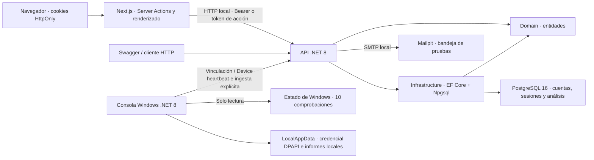
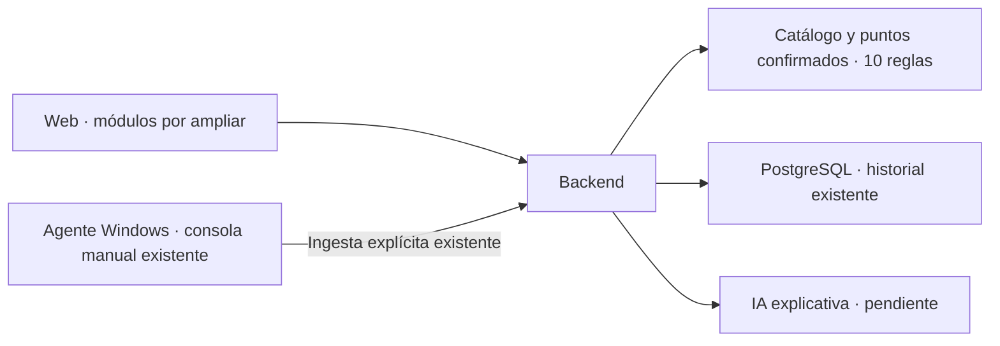

# Arquitectura de Security Center AI

Estado documentado: **2026-10-21**. La guía maestra v1.0 del 27 de julio de
2026 define el objetivo del producto. Esta arquitectura distingue el código
actual de las funciones futuras; las pruebas realizadas están en
[CHANGELOG.md](CHANGELOG.md).

## Componentes actuales

La web usa Next.js 16.4.2 App Router, React 19.3.1 y TypeScript 5.9.3.
La API utiliza ASP.NET Core .NET 8, EF Core y Npgsql. PostgreSQL 16 almacena
cuentas, sesiones, dispositivos y la base de resultados. Mailpit captura correo de desarrollo.
La consola Windows .NET 8 añade vinculación, heartbeat y diez comprobaciones
locales y envío manual. La API valida el reporte y calcula puntos confirmados
y cobertura con un catálogo versionado propio. Todavía no hay IA.

| Componente | Responsabilidad | Ubicación |
| --- | --- | --- |
| Web | Formularios, cuenta, dashboard, cookies y operaciones autenticadas desde el servidor. | [SecurityCenterAI.Web](src/SecurityCenterAI.Web) |
| API | Contratos HTTP, autenticación, sesiones, tokens de cuenta, correo y límites. | [SecurityCenterAI.Api](src/SecurityCenterAI.Api) |
| Domain | Cuenta, sesiones, dispositivos, códigos y credenciales, análisis, reglas y hallazgos. | [entidades](src/SecurityCenterAI.Domain/Entities) |
| Infrastructure | Modelo EF, relaciones, concurrencia, conexión y migraciones. | [SecurityCenterAI.Infrastructure](src/SecurityCenterAI.Infrastructure) |
| Agente Windows | Consola manual, cliente HTTP acotado, credencial protegida y diez comprobaciones locales de solo lectura. | [SecurityCenterAI.Agent](src/SecurityCenterAI.Agent) |
| Servicios locales | PostgreSQL persistente y Mailpit de pruebas, expuestos en loopback. | [Compose](docker-compose.yml) |

Las dependencias son `Api → Infrastructure`, `Api → Domain` e
`Infrastructure → Domain`. Domain no depende de las otras capas. Los
controladores y servicios usan `AppDbContext`; la ingesta y el cálculo se
mantienen separados del transporte HTTP, mediante DTO explícitos, inyección de
dependencias, operaciones asíncronas y cancelación. No hay una capa independiente
de casos de uso.

## Navegador y servidor Next.js

Las rutas son `/register`, `/login`, `/dashboard`, `/account`, `/devices`,
`/forgot-password`, `/reset-password`, `/verify-email` y `/session/renew`.
Dashboard y cuenta requieren una sesión aceptada por la API. La interfaz presenta
carga, error y ausencia de análisis; no crea resultados ficticios.

Next.js intermedia las solicitudes mediante Server Actions. Conserva el access
token en `security_center_session` y el refresh opaco en
`security_center_refresh`; ambas cookies usan `HttpOnly`, `SameSite=Lax`,
`Path=/` y `Secure` en producción. La primera vence con el access token y la
segunda con la credencial de renovación. No se utiliza `localStorage`.

El parser web lee claims y vencimiento para manejar navegación. No verifica
la firma ni concede permisos: .NET valida firma y sesión en la base.
`/account` consulta `/api/auth/me` para obtener el estado actual del correo,
en vez de tratar un claim antiguo como un perfil actualizado.

La renovación se realiza mediante una Server Action que puede escribir cookies.
`/session/renew` presenta ese recorrido cuando el access token ya venció;
la navegación GET por sí sola no llama al endpoint de renovación. Cuenta y
dashboard también coordinan la renovación mientras están abiertas. El uso
concurrente de un refresh antiguo puede revocar su sesión, por lo que no debe
tratarse la rotación como una operación libremente repetible.

Los formularios de verificación y recuperación leen el token del enlace y
exigen una acción POST para consumirlo. Esas páginas usan `no-referrer` y
`no-store`; la configuración de desarrollo omite sus solicitudes en el log
de entrada de Next.js. Esto no controla registros de un proxy o hosting futuro.

`API_BASE_URL` es exclusiva del servidor, por defecto
`http://localhost:5169`. Las solicitudes usan `cache: no-store` y timeout de
12 segundos. La clave JWT y las credenciales de PostgreSQL permanecen en el
backend. La web local se abre en `http://localhost:3000`.

## Autenticación y sesiones

Las contraseñas usan `PasswordHasher<User>`; el contrato actual admite de
8 a 128 caracteres para registro y recuperación. Se normaliza el correo y su
índice es único. No hay MFA ni una lista de contraseñas comprometidas.

El access token usa HMAC SHA-256, emisor, audiencia, expiración y los claims de
usuario y sesión. Su vigencia configurada es de 15 minutos, con 30 segundos
de tolerancia de reloj. `MapInboundClaims = false` conserva los nombres
originales. El middleware consulta el `sid` en PostgreSQL: una sesión
revocada, vencida o ajena al usuario invalida el token aunque su firma sea válida.

Los refresh son opacos, aleatorios y se guardan como SHA-256. Se rotan y tienen
una vigencia máxima de 30 días. Las credenciales consumidas se conservan para
detectar reutilización: volver a presentar una revoca la sesión asociada.
Los marcadores de concurrencia protegen las actualizaciones; no hay purga
automática de registros vencidos o consumidos.

Logout solicita revocación y borra las cookies del navegador. Si la API no
responde, la web informa del cierre local: una copia del token puede seguir
activa y la revocación remota queda sin confirmar. El cierre global
y el restablecimiento de contraseña revocan las sesiones de la cuenta.
Borrar solo una cookie no sustituye esa operación de backend.

## Correo, recuperación y controles de abuso

El correo de verificación y recuperación contiene un token opaco cuyo hash y
propósito se guardan en la base. Verificación dura 24 horas; recuperación,
30 minutos. Un token inválido, vencido, consumido o de propósito distinto
no permite completar la acción. El enlace se construye con `FrontendUrl`
configurada y no con el encabezado Host de una solicitud.

El registro permite entrar al dashboard mientras el correo está pendiente.
La cuenta muestra ese estado y permite pedir reenvío. Recuperación responde
de forma genérica; no entrega el token en su respuesta. Después de cambiar
la contraseña se exige login normal.

El bloqueo de login se activa tras 5 fallos y dura 15 minutos. El envío tiene
60 segundos de espera por cuenta y tipo de correo. Recuperación aplica un mínimo
de 300 ms; login inexistente realiza una verificación de hash de comparación.
Estas medidas reducen diferencias, sin garantizar tiempos idénticos.
Los límites de solicitudes por IP se mantienen
en memoria: 120/minuto global, 60/minuto de autenticación y 40/minuto de correo.
La API ve la IP de Next.js cuando actúa como intermediario y no confía en
`X-Forwarded-For`. Queda por definir la operación con proxies y varias instancias.

En desarrollo SMTP usa Mailpit: `127.0.0.1:1025` y bandeja
`http://localhost:8025`. Se valida que el host SMTP sea loopback en
Development/Testing. Fuera de esos entornos se requiere host y remitente
explícitos, usuario, contraseña, TLS y `FrontendUrl` HTTPS. No se ha elegido
un proveedor de producción. Mailpit contiene enlaces sensibles de prueba,
admite hasta 200 mensajes y no tiene volumen persistente en Compose.

La API encola el correo en memoria, con capacidad de 100 mensajes, y un worker
lo envía fuera de la solicitud HTTP. Los fallos generan una advertencia genérica
sin destinatario, token ni excepción. La cola no es durable y no hay reintentos
persistidos: un reinicio o fallo SMTP puede perder la entrega. La respuesta
genérica de recuperación no confirma que el correo ya haya sido entregado.

## Dispositivos y autorización separada

La web `/devices` opera como propietario con Bearer de usuario. Crear el registro
y emitir códigos exige correo verificado en la base y un máximo de un dispositivo
no revocado por cuenta. Un código de vinculación de un uso dura diez minutos y
su hash se almacena en la base. El canje entrega una credencial opaca propia,
válida durante 90 días, y consume el código de forma coordinada con la emisión.

El esquema `Device` autoriza heartbeat e ingesta del dispositivo vinculado; no permite
usar los endpoints de usuario. Bearer tampoco sustituye esa credencial en el
endpoint del cliente. El heartbeat actualiza el último contacto: no recoge
datos de Windows ni produce análisis o puntajes.

Regenerar invalida los códigos previos y mantiene una credencial existente hasta
el canje nuevo; este revoca la anterior. Revocar el dispositivo invalida códigos
y credenciales. Reset de contraseña revoca también esos secretos sin borrar
el registro ni el historial; logout-all solo revoca sesiones web. El estado
`linked` depende de una credencial vigente, mientras `pairedAtUtc` conserva la
fecha histórica. Las transiciones y los límites se comprueban en el backend.

Esta identidad de cliente no acredita identidad física del hardware. La consola
Windows utiliza este protocolo y protege su credencial local. El protocolo y sus límites están en
[docs/DEVICES.md](docs/DEVICES.md).

## Agente Windows de consola

`SecurityCenterAI.Agent` es una aplicación .NET 8 Windows de ejecución manual.
Sus comandos son `pair`, `heartbeat`, `status`, `scan`, `send`, `forget` y `help`,
expuestos también por `scripts/agent.ps1`. No es un servicio y no se registra
para iniciar con Windows. El uso completo está en [docs/WINDOWS_AGENT.md](docs/WINDOWS_AGENT.md).

`pair` lee el código mediante entrada interactiva oculta y canjea la credencial
sin utilizar contraseña o sesión de la cuenta. La URL de la API y la credencial
devuelta se guardan en `%LOCALAPPDATA%\SecurityCenterAI\Agent\credential.enc`,
protegidas con DPAPI `CurrentUser`. La URL queda ligada a la credencial para que
heartbeat use su destino original. El cliente exige HTTPS salvo HTTP en localhost
o una dirección IP de loopback exacta; no sigue redirecciones y acota tiempos
y respuestas. `status` consulta el estado local sin acreditar revocación remota.
`forget` borra la copia local, sin revocar el dispositivo ni borrar informes.

`scan` funciona sin vinculación y no hace solicitudes de resultados a la API
salvo cuando se solicita `--send` explícitamente.
Ejecuta consultas predeterminadas de solo lectura, selecciona campos de evidencia
y evalúa diez reglas locales versionadas. Un fallo de permisos, módulo ausente
o lectura inválida se conserva como desconocido o no aplicable según la evidencia,
sin convertirse en aprobación. Cada resultado incluye estado, evidencia,
severidad y recomendación; el cliente no calcula el puntaje. El informe JSON se guarda en
`%LOCALAPPDATA%\SecurityCenterAI\Agent\reports` al solicitar el análisis manual.
No se almacena la salida completa de cmdlets, seriales, nombre de usuario o
claves de recuperación. Los errores no deben exponer esos datos.

El informe del esquema 2 añade un UUID estable y puede enviarse con `scan --send`
o `send`. La API acepta únicamente observaciones de las diez reglas conocidas;
su catálogo determina los textos, severidad, recomendaciones y pesos, sin
confiar en esos metadatos del agente. `heartbeat` únicamente envía la versión
declarada del agente. La ingesta registra plataforma `Windows` por el protocolo
de las diez reglas; no verifica de forma remota la plataforma o el binario.

El cliente HTTP, la bóveda y las consultas son componentes separados. Reciben
por constructor sus dependencias, como `HttpClient`, `TimeProvider` e
`IWindowsProbe`; se utilizan DTO explícitos, métodos asíncronos y cancelación.
Quedan
instalador firmado, distribución, servicio, actualizador y controles
de operación de producción.

## Ingesta manual y cálculo

`POST /api/agent/analyses` requiere exclusivamente autenticación Device y obtiene
la cuenta y dispositivo de la credencial. El contrato del esquema 2 incluye
identificador estable de reporte, versión del cliente, fechas y exactamente
diez observaciones con regla/version, estado y evidencia seleccionada.
No permite elegir propietario, dispositivo, puntaje o pesos. La API valida
estructura, reglas admitidas, tamaño y fechas antes de guardar.

El identificador es único por dispositivo; un hash canónico del contenido
distingue reintentos idénticos (`200`) de reutilización con contenido diferente
(`409`). El primer envío devuelve `201`. Se guardan análisis y diez resultados
de forma coordinada; un reintento no crea otro historial. Las fechas declaradas
se conservan separadas de la recepción del servidor. La credencial se comprueba
en la base y no autoriza después de su revocación o vencimiento.

El cálculo versión 1 suma pesos de resultados `passed` sobre el peso aplicable.
`attention` no suma puntos y cuenta como conocido; `unknown` no suma puntos ni
se etiqueta como riesgo comprobado; `notApplicable` se excluye del denominador.
Cuando no hay conocidos el puntaje es `null`. La cobertura cuenta conocidos
sobre reglas aplicables, con valor 0 si ninguna es aplicable. El detalle
presenta las cuatro categorías y la falta de datos, sin convertir desconocidos
en aprobaciones ni sugerir una auditoría completa.

La autenticación prueba posesión de una credencial, no ejecución del binario ni
verdad de la evidencia. El reporte sigue siendo autodeclarado. El servidor no
consulta Windows remotamente. Las limitaciones y el protocolo preciso están en
[docs/ANALYSIS_INGESTION.md](docs/ANALYSIS_INGESTION.md).

## Persistencia

| Entidad / tabla | Finalidad y relación |
| --- | --- |
| `User` / `users` | Perfil, hash, correo verificado y estado de intentos y envíos. Correo único y marcador de concurrencia. |
| `UserSession` / `user_sessions` | Usuario, creación, vencimiento y revocación de cada sesión. |
| `RefreshCredential` / `refresh_credentials` | Hash de refresh, sesión, vigencia y consumo; hash único y concurrencia. |
| `AccountActionToken` / `account_action_tokens` | Hash, usuario, propósito, vigencia y consumo de enlaces de cuenta. |
| `SecurityAnalysis` / `security_analyses` | Cuenta/dispositivo, puntaje opcional, esquema/reporte/huella, captura y recepción, versión del cálculo y conteos. Metadatos opcionales conservan el historial legacy. |
| `Device` / `devices` | Propietario, nombre, fechas, versión de cliente declarada y estado de revocación. Índice parcial de un dispositivo no revocado por cuenta. |
| `DevicePairingCode` / `device_pairing_codes` | Hash del código, dispositivo, vencimiento, consumo, revocación y concurrencia. |
| `DeviceCredential` / `device_credentials` | Hash de credencial y vigencia; índice parcial de una credencial no revocada por dispositivo. |
| `SecurityRule` / `security_rules` | Clave compuesta de id y versión positiva, título, descripción y creación. Catálogo del servidor para las diez reglas admitidas; sin comandos remotos. |
| `SecurityFinding` / `security_findings` | Análisis, versión de regla, estado explícito y metadatos/evidencia/recomendación como instantáneas. Referencia compuesta a regla con borrado restringido. |

Las once propiedades persistidas de `User` se mapean con `HasColumnName` a
columnas en español en `users`: identificador `id_usuario`, perfil
`nombre_completo`/`correo_electronico`, hash `hash_contrasena` y campos de
seguridad y fechas descritos en [README.md](README.md#columnas-de-users).
Las propiedades C# y los contratos JSON conservan sus nombres. Las otras tablas
mantienen sus columnas y relaciones; las claves foráneas pasan a referenciar
`users.id_usuario`. El renombrado se versiona en una nueva migración, sin
reescribir las migraciones iniciales ni borrar datos.

El `Up` de `20261021120952_RenameUserColumnsToSpanish` ejecuta once operaciones
`RenameColumn` y un `RenameIndex` para `IX_users_correo_electronico`.
Su `Down` restaura los nombres anteriores; no recrea tablas o columnas.

Las relaciones dependen del usuario y tienen borrado en cascada. Esto no
implementa un endpoint para eliminar la cuenta. El inventario exacto, cookies,
correo y retención están en [PRIVACY_NOTES.md](PRIVACY_NOTES.md).

La migración `20261021114159_AccountSessionsAndRecovery` agrega seis columnas
al usuario y las tres tablas de cuentas a la migración inicial, sin eliminar
cuentas ni análisis. Las cuentas previas comienzan con `EmailVerified=false`.
Los JWT anteriores carecen de `sid`: requieren volver a iniciar sesión.

El dashboard devuelve `securityScore`, `totalAnalyses` y
`recentAnalyses`, hasta cinco registros por fecha descendente y filtrados
por usuario. Sin datos devuelve puntaje `null`, total 0 y lista vacía.
La ruta no ejecuta un análisis ni calcula puntajes.

El detalle de dispositivo filtra por usuario y equipo: hasta 20 análisis
recientes y 100 hallazgos por análisis. La lista devuelve hasta 100 dispositivos.
Son lecturas acotadas, sin paginación. Los análisis legacy con
`DeviceId=null` conservan su pertenencia al usuario en el dashboard y no se
atribuyen artificialmente a un equipo nuevo.

La migración `20261021123143_DevicesAndFindingFoundation` añade cinco tablas y
`security_analyses.id_dispositivo` nullable. Las columnas nuevas utilizan
español y las anteriores conservan sus nombres. La creación y las actualizaciones
de vinculación usan índices parciales y concurrencia. Pair y reemisión avanzan
también la versión del usuario para detectar carreras con restablecimiento de
contraseña; el canje utiliza una transacción relacional para sustituir la
credencial sin un estado intermedio visible.

## Configuración y verificación local

`global.json` selecciona SDK 8.0.4xx y el manifiesto local fija
`dotnet-ef` 8.0.11. `scripts/dev.ps1` carga las cuatro variables
admitidas de `.env` sin ejecutar su contenido; prepara conexión y clave JWT
solo para el proceso y restaura el entorno al salir. .NET no lee ese archivo
por sí solo. El helper inicia servicios, aplica migraciones y ejecuta la API
en el perfil HTTP y fija `ASPNETCORE_ENVIRONMENT=Development` para su proceso.
Admite `-Configuration` (por defecto Debug, también para EF y pruebas) y
`-Port` (por defecto 5169) para aislar binarios y dirección de otra instancia.
`migrate` requiere base disponible y `test` no necesita `.env`. El helper no
es un procedimiento de despliegue de producción.

Compose publica PostgreSQL en `127.0.0.1:5432` y conserva sus datos en
`postgres_data`. La API y la web corren en el anfitrión. El Dockerfile
de la API permite construir una imagen, pero Compose no despliega la web/API.
Los comandos están en [README.md](README.md).

Las pruebas del backend usan EF InMemory y correo capturado en memoria; no
validan por sí mismas SQL, migraciones o SMTP reales. Los E2E usan Chromium,
API, web, PostgreSQL y correo local de prueba; las cuentas se eliminan por
correo exacto y sus registros en cascada. Trazas, vídeos y capturas automáticas
están deshabilitados. Las capturas opcionales de revisión usan datos ficticios.
Los conteos y resultados de cada bloque constan en [CHANGELOG.md](CHANGELOG.md).

## Arquitectura objetivo de la guía

Quedan la distribución y operación del agente y las explicaciones de IA. El
recorrido manual de diez reglas ya conecta consola, API y web mediante un
cálculo determinista limitado. No equivale a una revisión completa de Windows.

El recorrido previsto es vincular el agente con un código temporal, entregar
una credencial propia y revocable, obtener evidencias con permisos mínimos,
evaluarlas con reglas y mostrar prioridades y recomendaciones en la web.
La IA explicará esos hechos; no decidirá el estado de Windows sin evidencia.
El agente no ejecutará comandos arbitrarios ni enviará archivos personales
fuera del alcance aprobado.

La sesión de cuenta no sustituye la credencial de dispositivo. Las recomendaciones
ejecutables y la auditoría completa siguen pendientes; las diez reglas y la
consulta de instantáneas no implementan esos procesos.
Tampoco están elegidos proveedor de IA, empaquetado del agente, colas ni hosting.
Retención, borrado, backups y operación de producción siguen pendientes.
Las decisiones se conservan en [DECISIONS.md](DECISIONS.md).
